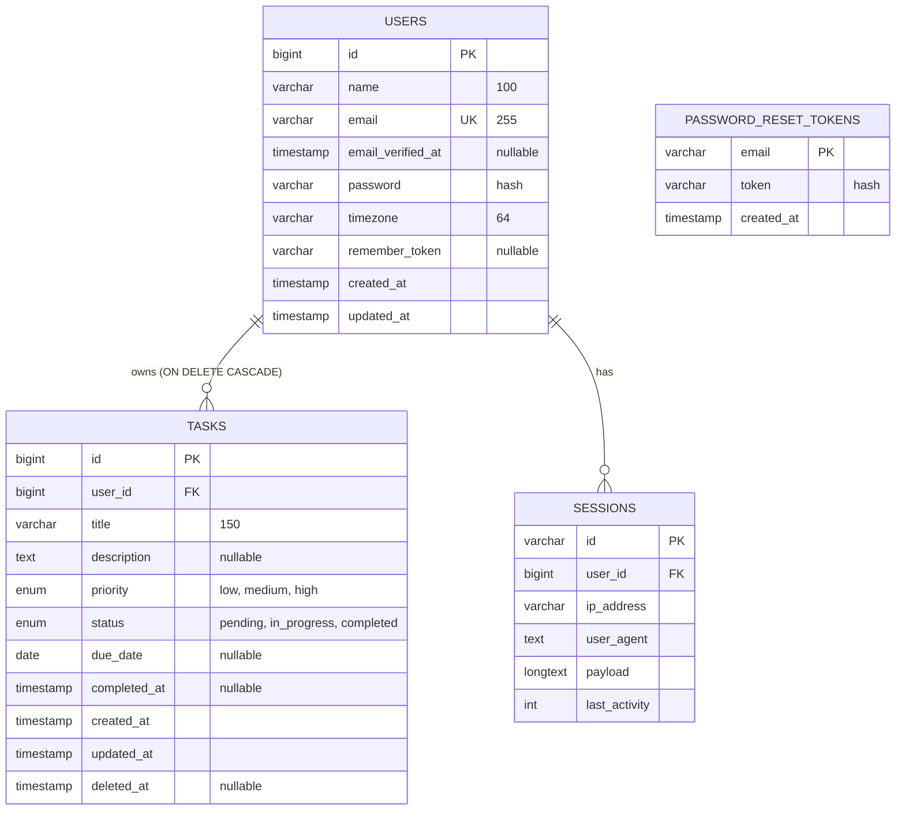
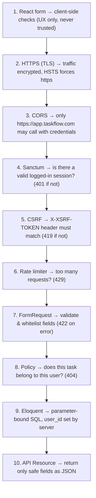
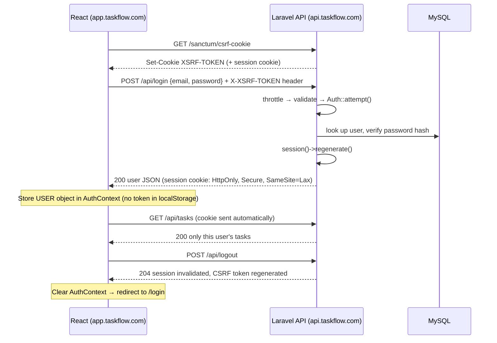

# TaskFlow — Complete Build Guide

A-to-Z analysis, feature specification, security implementation map and frontend–backend integration for the React + Laravel + MySQL task management system.

| Item | Detail |
| --- | --- |
| Application | TaskFlow – personal task management web app |
| Frontend | React (Vite), React Router, Axios, Tailwind CSS |
| Backend | PHP 8.2+, Laravel 11+, Laravel Sanctum (SPA cookie auth) |
| Database | MySQL 8 |
| Based on | TaskFlow Project Documentation (original plan) |
| Prepared for | Mathu |
| Date | 16 November 2026 |

> Diagrams are written in Mermaid. They render on GitHub, GitLab, VS Code (Markdown Preview Mermaid Support extension), Obsidian and Typora.

## Contents

- [1. Executive Summary](#1-executive-summary)
- [2. Review of the Original Plan](#2-review-of-the-original-plan)
  - [2.1 What the original plan gets right](#21-what-the-original-plan-gets-right)
  - [2.2 Gaps found and the decisions taken](#22-gaps-found-and-the-decisions-taken)
- [3. Final Technology Stack](#3-final-technology-stack)
- [4. System Architecture](#4-system-architecture)
  - [4.1 The big picture](#41-the-big-picture)
  - [4.2 Request lifecycle in one sentence per step](#42-request-lifecycle-in-one-sentence-per-step)
  - [4.3 Backend folder structure (Laravel)](#43-backend-folder-structure-laravel)
  - [4.4 Frontend folder structure (React)](#44-frontend-folder-structure-react)
- [5. Complete Feature Specification](#5-complete-feature-specification)
  - [5.1 MVP features (must have)](#51-mvp-features-must-have)
  - [5.2 MVP+ features (if time permits)](#52-mvp-features-if-time-permits)
  - [5.3 Phase 2 features](#53-phase-2-features)
  - [5.4 Phase 3 (future)](#54-phase-3-future)
  - [5.5 Business rules](#55-business-rules)
- [6. Database Design](#6-database-design)
  - [6.1 Entity relationship diagram](#61-entity-relationship-diagram)
  - [6.2 Table definitions](#62-table-definitions)
  - [6.3 Indexes](#63-indexes)
  - [6.4 Migration](#64-migration)
  - [6.5 Seed data](#65-seed-data)
- [7. Backend Implementation (Laravel)](#7-backend-implementation-laravel)
  - [7.1 Create the project](#71-create-the-project)
  - [7.2 Enums](#72-enums)
  - [7.3 Models](#73-models)
  - [7.4 Validation (Form Requests)](#74-validation-form-requests)
  - [7.5 Authorization (Policy)](#75-authorization-policy)
  - [7.6 Controllers](#76-controllers)
  - [7.7 API Resources (what JSON leaves the server)](#77-api-resources-what-json-leaves-the-server)
  - [7.8 Routes](#78-routes)
  - [7.9 bootstrap/app.php](#79-bootstrapappphp)
- [8. API Reference](#8-api-reference)
  - [8.1 Endpoints](#81-endpoints)
  - [8.2 Standard response formats](#82-standard-response-formats)
  - [8.3 Status codes and what React does](#83-status-codes-and-what-react-does)
  - [8.4 Example: create a task](#84-example-create-a-task)
  - [8.5 Example: list with filters](#85-example-list-with-filters)
- [9. Security Plan](#9-security-plan)
  - [9.1 Security implementation map](#91-security-implementation-map)
  - [9.2 Authentication mode: why cookies, not tokens in localStorage](#92-authentication-mode-why-cookies-not-tokens-in-localstorage)
  - [9.3 Session and cookie settings](#93-session-and-cookie-settings)
  - [9.4 CSRF protection](#94-csrf-protection)
  - [9.5 CORS configuration](#95-cors-configuration)
  - [9.6 Rate limiting and password rules](#96-rate-limiting-and-password-rules)
  - [9.7 Security headers](#97-security-headers)
  - [9.8 XSS prevention in React](#98-xss-prevention-in-react)
  - [9.9 Secrets and environment files](#99-secrets-and-environment-files)
  - [9.10 Error handling and logging](#910-error-handling-and-logging)
  - [9.11 OWASP coverage](#911-owasp-coverage)
- [10. Connecting the Frontend to the Backend](#10-connecting-the-frontend-to-the-backend)
  - [10.1 The connection checklist](#101-the-connection-checklist)
  - [10.2 Environment values (both sides must match)](#102-environment-values-both-sides-must-match)
  - [10.3 The Axios client](#103-the-axios-client)
  - [10.4 API service functions](#104-api-service-functions)
  - [10.5 Auth state (AuthContext)](#105-auth-state-authcontext)
  - [10.6 Protected and guest routes](#106-protected-and-guest-routes)
  - [10.7 Showing server validation errors in forms](#107-showing-server-validation-errors-in-forms)
  - [10.8 Task list with filters in the URL](#108-task-list-with-filters-in-the-url)
  - [10.9 Troubleshooting the connection](#109-troubleshooting-the-connection)
  - [10.10 Fallback: token mode (only if domains cannot be shared)](#1010-fallback-token-mode-only-if-domains-cannot-be-shared)
- [11. Frontend Implementation (React)](#11-frontend-implementation-react)
  - [11.1 Create the project](#111-create-the-project)
  - [11.2 Pages and their components](#112-pages-and-their-components)
  - [11.3 UI rules every page follows](#113-ui-rules-every-page-follows)
  - [11.4 Badges and dates](#114-badges-and-dates)
  - [11.5 Accessibility and quality](#115-accessibility-and-quality)
- [12. Testing Strategy](#12-testing-strategy)
  - [12.1 Test levels](#121-test-levels)
  - [12.2 Example backend tests](#122-example-backend-tests)
  - [12.3 Full test checklist](#123-full-test-checklist)
- [13. Deployment](#13-deployment)
  - [13.1 Environments](#131-environments)
  - [13.2 Server setup (single VPS example)](#132-server-setup-single-vps-example)
  - [13.3 Nginx configuration (key parts)](#133-nginx-configuration-key-parts)
  - [13.4 Production .env (backend)](#134-production-env-backend)
  - [13.5 Deploy commands](#135-deploy-commands)
  - [13.6 CI pipeline (GitHub Actions)](#136-ci-pipeline-github-actions)
  - [13.7 Backups and maintenance](#137-backups-and-maintenance)
- [14. Build Roadmap](#14-build-roadmap)
  - [14.1 One-day MVP plan (interview build)](#141-one-day-mvp-plan-interview-build)
  - [14.2 Full build plan (production quality)](#142-full-build-plan-production-quality)
- [15. Pre-Launch Checklist](#15-pre-launch-checklist)
  - [15.1 Security](#151-security)
  - [15.2 Functionality and quality](#152-functionality-and-quality)
- [16. Appendix](#16-appendix)
  - [16.1 Updated interview explanation](#161-updated-interview-explanation)
  - [16.2 Glossary](#162-glossary)

---

## 1. Executive Summary

TaskFlow is a full-stack task management web application. Registered users create tasks, give them a priority and a due date, move them through Pending → In Progress → Completed, and see their progress on a dashboard. The frontend is a React single-page application (SPA), the backend is a Laravel REST API, and MySQL stores the data.

This guide turns the original project plan into a complete build specification. It keeps every decision from the original plan, fills the gaps it left open, and adds the exact code, files and settings needed to build, secure, connect, test and deploy the application from an empty folder to a live HTTPS site.

#### What this guide gives you

- **A gap review** of the original plan, with a final decision for every open question (Section 2).
- **The final architecture and folder structure** for both the Laravel API and the React app (Sections 3–4).
- **A complete feature specification** split into MVP, Phase 2 and Phase 3, with acceptance criteria and business rules (Section 5).
- **The database design** with column types, indexes, constraints and migration code (Section 6).
- **Backend implementation**, file by file: models, enums, validation, policies, controllers, resources and routes (Section 7).
- **A full API reference** with request and response examples and a single error format (Section 8).
- **A security map** showing every security control, the layer it lives in, the exact file to put it in, and the code (Section 9).
- **Frontend ↔ backend connection**, step by step, including Sanctum cookie authentication, CSRF, CORS, the Axios client, auth state and error handling (Section 10).
- **Frontend implementation**, testing, deployment, a phased roadmap and a pre-launch checklist (Sections 11–15).

> 🔒 **THE ONE RULE THAT MATTERS MOST**
>
> The single most important rule in this project: **every task read, update and delete is checked for ownership on the server.** Hiding a button in React is not security. If a user changes a task ID in the URL or API request, Laravel must still refuse.

## 2. Review of the Original Plan

The original documentation is a solid starting point: the stack is sensible, the CRUD scope is clear, and it already names the right security concerns (hashing, ownership checks, validation, CORS, CSRF, rate limiting). Before building, a few open questions and gaps must be settled, because each one changes code in several places.

### 2.1 What the original plan gets right

- Clear MVP scope: authentication, task CRUD, priority, status and a dashboard.
- Correct principle that the task owner (`user_id`) is set by the server, never by the browser.
- Correct principle that validation must happen in Laravel, not only in React.
- Correct ownership query pattern: `Task::where('user_id', auth()->id())->findOrFail($id)`.
- A sensible one-to-many data model (one user, many tasks).

### 2.2 Gaps found and the decisions taken

| # | Gap in the original plan | Decision in this guide |
| --- | --- | --- |
| 1 | Authentication mode is contradictory: the tech table says "token-based", the security table mentions SPA cookie mode and CSRF. | **Use Sanctum SPA cookie (session) authentication.** No token is ever stored in the browser, so an XSS bug cannot steal a long-lived token. Token mode is documented as a fallback in 10.10. |
| 2 | Due date is "optional or required according to the final project rule". | **Optional.** On create it must be today or later. On update any valid date is accepted, so overdue tasks can still be edited. |
| 3 | No pagination on `GET /api/tasks`. | Paginate: 15 per page by default, maximum 50. |
| 4 | Only `PUT` for updates; changing just the status needs the whole task. | Support `PATCH` for partial updates (e.g. status only) and keep `PUT` for full updates. |
| 5 | Profile page exists but no profile or password endpoints. | Add `PATCH /api/user`, `PUT /api/user/password` and `DELETE /api/user`. |
| 6 | Dashboard has no overdue count; overdue rule has no timezone. | Dashboard returns an `overdue` count. "Today" is calculated in the user's timezone (stored on `users.timezone`). |
| 7 | No standard error response format. | One JSON error shape for all errors (Section 8.2). |
| 8 | Reading another user's task: 403 or 404 not decided. | Return **404 Not Found**, so an attacker cannot even confirm the task exists. |
| 9 | No completion time is stored. | Add `completed_at`; set it automatically when status becomes Completed. |
| 10 | No database indexes specified. | Composite indexes on `(user_id, status)` and `(user_id, due_date)` (Section 6.3). |
| 11 | Testing is manual only. | Automated feature tests for auth, validation and ownership, plus Postman (Section 12). |
| 12 | No deployment, environment or logging plan. | Deployment, HTTPS, production `.env` and CI pipeline (Section 13). |
| 13 | No forgot-password, email verification or session management. | Planned as Phase 2 with exact implementation notes (Section 5.3). |

## 3. Final Technology Stack

Use the current stable release of each tool at the time you start. Version notes below are minimums that the code in this guide assumes.

| Layer | Technology | Version / notes | Why |
| --- | --- | --- | --- |
| Frontend | React + Vite | React 18 or later; Vite as the build tool | Fast dev server, simple production build to static files. |
| Routing | React Router | v6.4+ (data router) or v7 | Page routes and protected routes. |
| HTTP client | Axios | 1.6.2 or later | Needed for the `withXSRFToken` option used with Sanctum across subdomains. |
| Styling | Tailwind CSS | Current | Utility classes, responsive layout without writing much CSS. |
| Forms (optional) | React Hook Form + Zod | Current | Less boilerplate for form state and client-side checks. |
| Backend | PHP + Laravel | PHP 8.2+; Laravel 11 or later | Code uses the Laravel 11+ structure (`bootstrap/app.php`). |
| Auth | Laravel Sanctum | Installed by `php artisan install:api` | Cookie-based SPA authentication with CSRF protection. |
| Database | MySQL | 8.0+ | Relational data, foreign keys, indexes. |
| Testing | Pest or PHPUnit; Vitest + React Testing Library | Current | Automated backend and frontend tests. |
| API testing | Postman (or Bruno / Insomnia) | Current | Manual endpoint checks and a shareable collection. |
| Web server | Nginx + PHP-FPM | Current | Serves the API and the built React files over HTTPS. |
| Version control / CI | Git, GitHub, GitHub Actions | Current | Code history and automatic tests on every push. |

## 4. System Architecture

### 4.1 The big picture

The browser loads the React app from one subdomain and calls the Laravel API on a sibling subdomain. Both share the same parent domain, which is what allows Sanctum's secure session cookie to work.

```mermaid
flowchart LR
    U(["User (Browser)"])
    subgraph FE["FRONTEND — https://app.taskflow.com"]
      R["React SPA (Vite)<br/>Pages + Components"] --> C["AuthContext<br/>Protected Routes"] --> A["Axios client<br/>src/api/client.js<br/>withCredentials + XSRF"]
    end
    subgraph BE["BACKEND — https://api.taskflow.com"]
      N["Nginx + HTTPS<br/>Security headers"] --> M["Middleware<br/>CORS · Sanctum<br/>CSRF · Throttle"] --> K["Controllers<br/>FormRequests<br/>Policies"] --> O["Eloquent Models<br/>API Resources"]
    end
    DB[("MySQL 8<br/>users · tasks · sessions")]
    U -- "clicks / forms" --> R
    A -- "HTTPS JSON + session cookie" --> N
    O -- "SQL with bound parameters" --> DB
```



*Figure 1 – TaskFlow architecture: React SPA → HTTPS → Laravel API → MySQL*

| Environment | Frontend URL | Backend URL |
| --- | --- | --- |
| Local development | `http://localhost:5173` | `http://localhost:8000` |
| Production | `https://app.taskflow.com` | `https://api.taskflow.com` |

> ⚠️ **IMPORTANT**
>
> Frontend and backend must share the same parent domain (e.g. `*.taskflow.com`) for cookie authentication. If you must host them on unrelated domains (e.g. a Vercel URL plus a different API host), use token mode instead (Section 10.10).

### 4.2 Request lifecycle in one sentence per step

1. The user submits a form in React (e.g. Add Task).
2. React calls a function in the API service layer, which uses the shared Axios client.
3. Axios sends the request over HTTPS with the session cookie and the `X-XSRF-TOKEN` header.
4. Laravel middleware checks CORS, the session (Sanctum), the CSRF token and the rate limit.
5. A FormRequest class validates the input and drops any field that is not allowed.
6. A Policy confirms the task belongs to the logged-in user.
7. Eloquent reads or writes MySQL using bound parameters.
8. An API Resource shapes the JSON response, exposing only safe fields.
9. React updates the page, or shows the validation or error message.

### 4.3 Backend folder structure (Laravel)

*Laravel API*

```text
taskflow-api/
├── app/
│   ├── Enums/
│   │   ├── TaskPriority.php
│   │   └── TaskStatus.php
│   ├── Http/
│   │   ├── Controllers/Api/
│   │   │   ├── AuthController.php        # register, login, logout, me
│   │   │   ├── ProfileController.php     # update profile, password, delete account
│   │   │   ├── TaskController.php        # CRUD + filters
│   │   │   └── DashboardController.php   # statistics
│   │   ├── Middleware/
│   │   │   └── SecurityHeaders.php
│   │   ├── Requests/
│   │   │   ├── Auth/LoginRequest.php
│   │   │   ├── Auth/RegisterRequest.php
│   │   │   ├── Profile/UpdateProfileRequest.php
│   │   │   ├── Profile/UpdatePasswordRequest.php
│   │   │   ├── Task/IndexTaskRequest.php
│   │   │   ├── Task/StoreTaskRequest.php
│   │   │   └── Task/UpdateTaskRequest.php
│   │   └── Resources/
│   │       ├── TaskResource.php
│   │       └── UserResource.php
│   ├── Models/
│   │   ├── Task.php
│   │   └── User.php
│   ├── Policies/
│   │   └── TaskPolicy.php
│   └── Providers/AppServiceProvider.php  # rate limiters, password rules
├── bootstrap/app.php                     # middleware, exceptions
├── config/ (cors.php, sanctum.php, session.php)
├── database/
│   ├── factories/ (UserFactory.php, TaskFactory.php)
│   ├── migrations/
│   └── seeders/DatabaseSeeder.php
├── routes/api.php
├── tests/Feature/ (AuthTest, TaskCrudTest, TaskOwnershipTest, DashboardTest)
└── .env  (never committed)
```

### 4.4 Frontend folder structure (React)

*React app*

```text
taskflow-web/
├── src/
│   ├── api/
│   │   ├── client.js          # one Axios instance + interceptors
│   │   ├── auth.js            # register, login, logout, me
│   │   ├── tasks.js           # list, get, create, update, remove
│   │   ├── dashboard.js
│   │   └── profile.js
│   ├── context/
│   │   └── AuthContext.jsx    # current user, login/logout functions
│   ├── routes/
│   │   ├── ProtectedRoute.jsx # only for logged-in users
│   │   └── GuestRoute.jsx     # only for logged-out users
│   ├── pages/
│   │   ├── LoginPage.jsx  RegisterPage.jsx  DashboardPage.jsx
│   │   ├── TasksPage.jsx  TaskFormPage.jsx  TaskDetailPage.jsx
│   │   ├── ProfilePage.jsx  NotFoundPage.jsx
│   ├── components/
│   │   ├── layout/ (AppLayout, Navbar, Sidebar)
│   │   ├── tasks/ (TaskCard, TaskTable, TaskFilters, StatusBadge,
│   │   │          PriorityBadge, OverdueBadge, DeleteTaskDialog)
│   │   ├── dashboard/ (StatCard, RecentTasks, UpcomingDeadlines)
│   │   └── ui/ (Button, Input, Select, Spinner, EmptyState, Toast, Pagination)
│   ├── hooks/ (useTasks.js, useDebounce.js)
│   ├── utils/ (apiErrors.js, dates.js)
│   ├── App.jsx  main.jsx  index.css
├── .env.development  .env.production
└── vite.config.js
```

## 5. Complete Feature Specification

Features are split into three phases. Build and test the MVP completely before starting Phase 2. Each feature has acceptance criteria: the feature is done only when every criterion passes.

### 5.1 MVP features (must have)

| Area | Feature | Acceptance criteria |
| --- | --- | --- |
| Auth | Register | Name (2–100 chars), email (valid, unique), password (min 8, letters + numbers, not in known breach lists) + confirmation. On success the user is logged in and sent to the Dashboard. Duplicate email shows a field error. |
| Auth | Login | Email + password, show/hide password toggle, optional "Remember me". Wrong details show one generic message ("These credentials do not match our records"). 5 failed attempts per minute per email + IP returns 429 with a "try again in N seconds" message. |
| Auth | Logout | Ends the server session, clears user state in React, redirects to Login. Back button must not show private data. |
| Auth | Session restore | Refreshing the browser keeps the user logged in (React calls `GET /api/user` on load). Expired session redirects to Login. |
| Auth | Route guards | Logged-out users opening `/tasks` go to `/login` and return to `/tasks` after login. Logged-in users opening `/login` go to `/dashboard`. |
| Tasks | Create task | Title required (1–150), description optional (max 5,000), priority (low/medium/high, default medium), status (default pending), due date optional, not in the past. Saved task appears in the list immediately. |
| Tasks | List tasks | Shows only the logged-in user's tasks, paginated (15 per page), newest first by default. Each row shows title, priority badge, status badge, due date and an Overdue badge where relevant. |
| Tasks | View task | Shows all fields plus created/updated/completed times. Opening another user's task ID shows "Task not found". |
| Tasks | Edit task | Form pre-filled; Save validates on the server and shows field errors under each input; Cancel returns without saving. |
| Tasks | Quick status change | Status can be changed from the list with one click (sends `PATCH` with status only). |
| Tasks | Delete task | Confirmation dialog naming the task; on confirm the task disappears and a success toast shows. |
| Dashboard | Statistics | Cards for Total, Pending, In Progress, Completed and Overdue. Numbers match the user's own tasks exactly. |
| Dashboard | Recent & upcoming | 5 most recently updated tasks; tasks due in the next 7 days that are not completed. |
| Profile | View & update | Update name and email (email unique). Change password requires current password. Logout button. |
| UX | States | Every page handles loading, empty, error and success states. Buttons are disabled while saving (no double submit). |
| UX | Responsive | Usable on 360 px wide phones up to desktop. |

### 5.2 MVP+ features (if time permits)

| Feature | Details |
| --- | --- |
| Search | Search by title (debounced 300 ms). Server-side `LIKE` query on the user's tasks only. |
| Filters | Status, priority and "overdue only" filters. Filters are kept in the URL query string so refresh and Back keep them. |
| Sorting | Sort by due date, priority, created date or title, ascending or descending. Server accepts only these fields. |
| Overdue display | Red "Overdue" badge when `due_date < today` and status is not Completed. Calculated on the server (`is_overdue`). |
| Due-soon highlight | Amber badge when due today or tomorrow. |
| Timezone | User picks a timezone on the profile (default Asia/Colombo or browser timezone) so "today" is correct for them. |

### 5.3 Phase 2 features

| Feature | How to implement |
| --- | --- |
| Forgot / reset password | Laravel `Password::sendResetLink()` and `Password::reset()`; endpoints `POST /api/forgot-password` and `POST /api/reset-password`. Always reply "If that email exists, a link has been sent" (prevents account discovery). Tokens expire in 60 minutes, single use. |
| Email verification | `User implements MustVerifyEmail`; protect task routes with the `verified` middleware; resend endpoint throttled to 6 per minute. |
| Account deletion | `DELETE /api/user` requires the current password; deletes tasks via cascade; logs the user out. |
| Active sessions | List sessions from the `sessions` table (device, IP, last active) and "log out other devices". |
| Soft delete + undo | Tasks use `SoftDeletes`; toast offers "Undo" for 10 seconds (`POST /api/tasks/{id}/restore`). |
| Labels / categories | New `labels` table (user_id, name, colour) and `label_task` pivot. Same ownership rules as tasks. |
| Bulk actions | Select many tasks → mark completed or delete. Server checks ownership of every ID. |
| Data export | Download own tasks as CSV. |

### 5.4 Phase 3 (future)

- Email or in-app reminders for tasks due tomorrow (Laravel scheduler + queued notifications).
- Sub-tasks / checklists inside a task.
- File attachments (private storage, size and type limits, virus scan, signed download URLs).
- Team workspaces and shared tasks (needs roles and a new authorization model).
- Reports: completed per week, average completion time (uses `completed_at`).
- Two-factor authentication (TOTP) and activity log.
- Dark mode and keyboard shortcuts.

### 5.5 Business rules

| Rule | Definition | Where it is enforced |
| --- | --- | --- |
| Ownership | A task belongs to exactly one user. Only that user can see or change it. | Server: relationship queries + `TaskPolicy`. |
| Owner assignment | `user_id` is always `auth()->id()`. Any `user_id` sent by the browser is ignored. | Server: `$request->user()->tasks()->create(...)`; `user_id` not in `$fillable`. |
| Allowed values | Priority: `low`, `medium`, `high`. Status: `pending`, `in_progress`, `completed`. | PHP enums + `Rule::enum()` + MySQL ENUM column. |
| Defaults | Priority `medium`, status `pending`. | Database default + React form default. |
| Due date | Optional. On create: today or later. On update: any valid date. | `StoreTaskRequest` / `UpdateTaskRequest`. |
| Overdue | `due_date` < today (user timezone) AND status ≠ completed. | Model scope `overdue()` and `TaskResource::is_overdue`. |
| Completion time | When status becomes completed, `completed_at = now()`. If it moves back, `completed_at = null`. | `Task` model `saving` event. |
| Status flow | Any status can move to any other (users may reopen tasks). | No extra rule needed; add one later if required. |

## 6. Database Design

### 6.1 Entity relationship diagram



*Figure 2 – Tables and relationships. One user has many tasks.*

### 6.2 Table definitions

#### users

| Column | Type | Rules |
| --- | --- | --- |
| id | BIGINT UNSIGNED, PK, auto increment |  |
| name | VARCHAR(100) | Required |
| email | VARCHAR(255) | Required, **UNIQUE**, stored lower-case |
| email_verified_at | TIMESTAMP NULL | Phase 2 email verification |
| password | VARCHAR(255) | Bcrypt/Argon2 hash only, never plain text |
| timezone | VARCHAR(64) | Default `Asia/Colombo`; validated against PHP timezone list |
| remember_token | VARCHAR(100) NULL | Used by "Remember me" |
| created_at, updated_at | TIMESTAMP |  |

#### tasks

| Column | Type | Rules |
| --- | --- | --- |
| id | BIGINT UNSIGNED, PK |  |
| user_id | BIGINT UNSIGNED, FK → users.id | NOT NULL, `ON DELETE CASCADE` |
| title | VARCHAR(150) | Required |
| description | TEXT NULL | Max 5,000 chars (validated) |
| priority | ENUM('low','medium','high') | Default 'medium' |
| status | ENUM('pending','in_progress','completed') | Default 'pending' |
| due_date | DATE NULL | Date only, no time |
| completed_at | TIMESTAMP NULL | Set automatically |
| created_at, updated_at | TIMESTAMP |  |
| deleted_at | TIMESTAMP NULL | Soft deletes (Phase 2 undo; harmless to add now) |

Laravel also creates `sessions`, `password_reset_tokens`, `cache`, `jobs` and (if you use token mode) `personal_access_tokens`. Keep the session driver as `database` so you can list and revoke sessions later.

### 6.3 Indexes

| Index | Why |
| --- | --- |
| `users.email` UNIQUE | Fast login lookup; prevents duplicate accounts even under race conditions. |
| `tasks (user_id, status)` | Task list filtered by status and dashboard counts. |
| `tasks (user_id, due_date)` | Sorting by due date, overdue and upcoming queries. |
| `tasks (user_id, created_at)` | Default "newest first" list. |

> ℹ️ **NOTE**
>
> Searching with `LIKE '%word%'` cannot use an index. That is fine for a personal task list (hundreds of rows per user, already narrowed by `user_id`). Add a FULLTEXT index only if search becomes slow.

### 6.4 Migration

*PHP – migrations*

```php
// database/migrations/xxxx_add_timezone_to_users_table.php
Schema::table('users', function (Blueprint $table) {
    $table->string('timezone', 64)->default('Asia/Colombo')->after('password');
});

// database/migrations/xxxx_create_tasks_table.php
Schema::create('tasks', function (Blueprint $table) {
    $table->id();
    $table->foreignId('user_id')->constrained()->cascadeOnDelete();
    $table->string('title', 150);
    $table->text('description')->nullable();
    $table->enum('priority', ['low', 'medium', 'high'])->default('medium');
    $table->enum('status', ['pending', 'in_progress', 'completed'])->default('pending');
    $table->date('due_date')->nullable();
    $table->timestamp('completed_at')->nullable();
    $table->timestamps();
    $table->softDeletes();

    $table->index(['user_id', 'status']);
    $table->index(['user_id', 'due_date']);
    $table->index(['user_id', 'created_at']);
});
```

### 6.5 Seed data

Create two demo users with about 30 tasks each using factories. Two users are essential: they let you test that User A can never see User B's tasks.

*PHP – factories & seeder*

```php
// database/factories/TaskFactory.php
public function definition(): array
{
    return [
        'title'       => fake()->sentence(4),
        'description' => fake()->optional()->paragraph(),
        'priority'    => fake()->randomElement(TaskPriority::cases()),
        'status'      => fake()->randomElement(TaskStatus::cases()),
        'due_date'    => fake()->optional()->dateTimeBetween('-10 days', '+30 days'),
    ];
}

// database/seeders/DatabaseSeeder.php
User::factory()->has(Task::factory()->count(30))->create(['email' => 'alice@example.com']);
User::factory()->has(Task::factory()->count(30))->create(['email' => 'bob@example.com']);
```

> ⚠️ **IMPORTANT**
>
> Never run the seeder in production. Demo passwords from `UserFactory` (usually "password") must not exist on a live server.

## 7. Backend Implementation (Laravel)

Build the backend first and test it with Postman before writing React pages. Follow the steps in order.

### 7.1 Create the project

*Terminal*

```bash
composer create-project laravel/laravel taskflow-api
cd taskflow-api
php artisan install:api          # installs Sanctum + routes/api.php
php artisan config:publish cors  # creates config/cors.php
# edit .env (database, session, sanctum values – see Section 10.2)
php artisan migrate
```

### 7.2 Enums

*PHP – enums*

```php
// app/Enums/TaskStatus.php
namespace App\Enums;

enum TaskStatus: string
{
    case Pending    = 'pending';
    case InProgress = 'in_progress';
    case Completed  = 'completed';
}

// app/Enums/TaskPriority.php
enum TaskPriority: string
{
    case Low    = 'low';
    case Medium = 'medium';
    case High   = 'high';
}
```

### 7.3 Models

*PHP – User model*

```php
// app/Models/User.php  (relevant parts)
protected $fillable = ['name', 'email', 'password', 'timezone'];
protected $hidden   = ['password', 'remember_token'];

protected function casts(): array
{
    return [
        'email_verified_at' => 'datetime',
        'password'          => 'hashed',   // hashes automatically on save
    ];
}

public function tasks(): HasMany
{
    return $this->hasMany(Task::class);
}

public function today(): string
{
    return now($this->timezone)->toDateString();
}
```

*PHP – Task model*

```php
// app/Models/Task.php
class Task extends Model
{
    use HasFactory, SoftDeletes;

    // user_id is NOT fillable – it is always set through the relationship
    protected $fillable = ['title', 'description', 'priority', 'status', 'due_date'];

    protected function casts(): array
    {
        return [
            'priority'     => TaskPriority::class,
            'status'       => TaskStatus::class,
            'due_date'     => 'date:Y-m-d',
            'completed_at' => 'datetime',
        ];
    }

    protected static function booted(): void
    {
        static::saving(function (Task $task) {
            if ($task->isDirty('status')) {
                $task->completed_at = $task->status === TaskStatus::Completed ? now() : null;
            }
        });
    }

    public function user(): BelongsTo
    {
        return $this->belongsTo(User::class);
    }

    public function scopeOverdue(Builder $q, string $today): Builder
    {
        return $q->where('status', '!=', TaskStatus::Completed)
                 ->whereNotNull('due_date')
                 ->where('due_date', '<', $today);
    }
}
```

> 💡 **TIP**
>
> In `AppServiceProvider::boot()` add `Model::shouldBeStrict(! app()->isProduction());`. In development this throws an error if you assign a field that is not fillable or lazy-load relations by accident, which catches mass-assignment and performance bugs early.

### 7.4 Validation (Form Requests)

Every endpoint that accepts input has its own FormRequest. Controllers only ever use `$request->validated()`, so unknown fields (such as `user_id` or `id`) are silently dropped.

*PHP – task validation*

```php
// app/Http/Requests/Task/StoreTaskRequest.php
public function authorize(): bool { return true; } // ownership is handled by the policy

public function rules(): array
{
    return [
        'title'       => ['required', 'string', 'min:1', 'max:150'],
        'description' => ['nullable', 'string', 'max:5000'],
        'priority'    => ['sometimes', Rule::enum(TaskPriority::class)],
        'status'      => ['sometimes', Rule::enum(TaskStatus::class)],
        'due_date'    => ['nullable', 'date_format:Y-m-d',
                          'after_or_equal:' . $this->user()->today()],
    ];
}

protected function prepareForValidation(): void
{
    $this->merge(['title' => trim((string) $this->title)]);
}

// app/Http/Requests/Task/UpdateTaskRequest.php  (PUT and PATCH)
public function rules(): array
{
    $required = $this->isMethod('put') ? 'required' : 'sometimes';
    return [
        'title'       => [$required, 'string', 'min:1', 'max:150'],
        'description' => ['sometimes', 'nullable', 'string', 'max:5000'],
        'priority'    => [$required, Rule::enum(TaskPriority::class)],
        'status'      => [$required, Rule::enum(TaskStatus::class)],
        'due_date'    => ['sometimes', 'nullable', 'date_format:Y-m-d'],
    ];
}
```

*PHP – list & auth validation*

```php
// app/Http/Requests/Task/IndexTaskRequest.php  (query string for GET /api/tasks)
public function rules(): array
{
    return [
        'search'   => ['nullable', 'string', 'max:100'],
        'status'   => ['nullable', Rule::enum(TaskStatus::class)],
        'priority' => ['nullable', Rule::enum(TaskPriority::class)],
        'overdue'  => ['nullable', 'boolean'],
        'sort'     => ['nullable', Rule::in(['created_at', 'due_date', 'priority', 'title'])],
        'direction'=> ['nullable', Rule::in(['asc', 'desc'])],
        'per_page' => ['nullable', 'integer', 'min:1', 'max:50'],
        'page'     => ['nullable', 'integer', 'min:1'],
    ];
}

// app/Http/Requests/Auth/RegisterRequest.php
public function rules(): array
{
    return [
        'name'     => ['required', 'string', 'min:2', 'max:100'],
        'email'    => ['required', 'string', 'lowercase', 'email:rfc', 'max:255',
                       Rule::unique('users', 'email')],
        'password' => ['required', 'confirmed', Password::defaults()],
    ];
}

// app/Http/Requests/Auth/LoginRequest.php
public function rules(): array
{
    return [
        'email'    => ['required', 'string', 'email'],
        'password' => ['required', 'string'],
        'remember' => ['sometimes', 'boolean'],
    ];
}
```

### 7.5 Authorization (Policy)

*PHP – TaskPolicy*

```php
// app/Policies/TaskPolicy.php   (auto-discovered for App\Models\Task)
use Illuminate\Auth\Access\Response;

class TaskPolicy
{
    private function owns(User $user, Task $task): Response
    {
        return $user->id === $task->user_id
            ? Response::allow()
            : Response::denyAsNotFound();   // 404, not 403 – hides existence
    }

    public function view(User $user, Task $task): Response   { return $this->owns($user, $task); }
    public function update(User $user, Task $task): Response { return $this->owns($user, $task); }
    public function delete(User $user, Task $task): Response { return $this->owns($user, $task); }
}
```

### 7.6 Controllers

*PHP – AuthController*

```php
// app/Http/Controllers/Api/AuthController.php
class AuthController extends Controller
{
    public function register(RegisterRequest $request)
    {
        $user = User::create($request->validated());   // password hashed by cast
        Auth::login($user);
        $request->session()->regenerate();
        return (new UserResource($user))->response()->setStatusCode(201);
    }

    public function login(LoginRequest $request)
    {
        $credentials = $request->only('email', 'password');
        $credentials['email'] = Str::lower($credentials['email']);

        if (! Auth::attempt($credentials, $request->boolean('remember'))) {
            throw ValidationException::withMessages([
                'email' => __('auth.failed'),   // same message for wrong email or password
            ]);
        }
        $request->session()->regenerate();      // prevents session fixation
        return new UserResource($request->user());
    }

    public function logout(Request $request)
    {
        Auth::guard('web')->logout();
        $request->session()->invalidate();
        $request->session()->regenerateToken();
        return response()->noContent();
    }

    public function me(Request $request)
    {
        return new UserResource($request->user());
    }
}
```

*PHP – TaskController*

```php
// app/Http/Controllers/Api/TaskController.php
class TaskController extends Controller
{
    public function index(IndexTaskRequest $request)
    {
        $user  = $request->user();
        $sort  = $request->input('sort', 'created_at');
        $dir   = $request->input('direction', 'desc');

        $tasks = $user->tasks()                                   // ownership by design
            ->when($request->filled('search'), function ($q) use ($request) {
                $term = addcslashes($request->search, '%_\\');   // escape LIKE wildcards
                $q->where('title', 'like', "%{$term}%");
            })
            ->when($request->filled('status'),   fn ($q) => $q->where('status', $request->status))
            ->when($request->filled('priority'), fn ($q) => $q->where('priority', $request->priority))
            ->when($request->boolean('overdue'), fn ($q) => $q->overdue($user->today()))
            ->orderBy($sort, $dir)->orderBy('id', 'desc')
            ->paginate($request->integer('per_page', 15))
            ->withQueryString();

        return TaskResource::collection($tasks);
    }

    public function store(StoreTaskRequest $request)
    {
        $task = $request->user()->tasks()->create($request->validated());
        return (new TaskResource($task->refresh()))->response()->setStatusCode(201);
    }

    public function show(Task $task)
    {
        Gate::authorize('view', $task);
        return new TaskResource($task);
    }

    public function update(UpdateTaskRequest $request, Task $task)
    {
        Gate::authorize('update', $task);
        $task->update($request->validated());
        return new TaskResource($task);
    }

    public function destroy(Task $task)
    {
        Gate::authorize('delete', $task);
        $task->delete();
        return response()->noContent();
    }
}
```

> 🔒 **SECURITY**
>
> Two layers protect ownership. `index` and `store` work through `$request->user()->tasks()`, so they physically cannot touch another user's rows. `show`, `update` and `destroy` receive a task through route model binding and then call `Gate::authorize()`, which uses `TaskPolicy`. Do not remove either layer.

*PHP – DashboardController*

```php
// app/Http/Controllers/Api/DashboardController.php
public function __invoke(Request $request)
{
    $user  = $request->user();
    $today = $user->today();

    $counts = $user->tasks()->toBase()
        ->selectRaw('COUNT(*) AS total')
        ->selectRaw("SUM(status = 'pending') AS pending")
        ->selectRaw("SUM(status = 'in_progress') AS in_progress")
        ->selectRaw("SUM(status = 'completed') AS completed")
        ->selectRaw("SUM(status <> 'completed' AND due_date < ?) AS overdue", [$today])
        ->first();

    return response()->json(['data' => [
        'counts'   => array_map('intval', (array) $counts),
        'recent'   => TaskResource::collection($user->tasks()->latest('updated_at')->limit(5)->get()),
        'upcoming' => TaskResource::collection(
            $user->tasks()->where('status', '!=', 'completed')
                 ->whereBetween('due_date', [$today, now($user->timezone)->addDays(7)->toDateString()])
                 ->orderBy('due_date')->limit(5)->get()),
    ]]);
}
```

*PHP – ProfileController*

```php
// app/Http/Controllers/Api/ProfileController.php
public function update(UpdateProfileRequest $request)       // name, email (unique ignoring self), timezone
{
    $request->user()->update($request->validated());
    return new UserResource($request->user());
}

public function password(UpdatePasswordRequest $request)    // current_password, password, password_confirmation
{
    $user = $request->user();
    $user->update(['password' => $request->validated('password')]);

    // sign out every other session of this user
    DB::table('sessions')->where('user_id', $user->id)
        ->where('id', '!=', $request->session()->getId())->delete();
    $request->session()->regenerate();

    return response()->noContent();
}

// UpdatePasswordRequest rules:
// 'current_password' => ['required', 'current_password'],
// 'password'         => ['required', 'confirmed', Password::defaults(), 'different:current_password'],
```

### 7.7 API Resources (what JSON leaves the server)

*PHP – Resources*

```php
// app/Http/Resources/TaskResource.php
public function toArray(Request $request): array
{
    $today = $request->user()?->today() ?? now()->toDateString();
    return [
        'id'           => $this->id,
        'title'        => $this->title,
        'description'  => $this->description,
        'priority'     => $this->priority->value,
        'status'       => $this->status->value,
        'due_date'     => $this->due_date?->format('Y-m-d'),
        'is_overdue'   => $this->due_date !== null
                          && $this->status !== TaskStatus::Completed
                          && $this->due_date->format('Y-m-d') < $today,
        'completed_at' => $this->completed_at?->toIso8601String(),
        'created_at'   => $this->created_at->toIso8601String(),
        'updated_at'   => $this->updated_at->toIso8601String(),
    ];
}

// app/Http/Resources/UserResource.php  – never include password or tokens
return ['id' => $this->id, 'name' => $this->name, 'email' => $this->email,
        'timezone' => $this->timezone, 'email_verified' => $this->email_verified_at !== null];
```

### 7.8 Routes

*PHP – routes/api.php*

```php
// routes/api.php
Route::middleware('guest')->group(function () {
    Route::post('/register', [AuthController::class, 'register'])->middleware('throttle:register');
    Route::post('/login',    [AuthController::class, 'login'])->middleware('throttle:login');
});

Route::middleware(['auth:sanctum', 'throttle:api'])->group(function () {
    Route::post('/logout', [AuthController::class, 'logout']);
    Route::get('/user',    [AuthController::class, 'me']);
    Route::patch('/user',  [ProfileController::class, 'update']);
    Route::put('/user/password', [ProfileController::class, 'password'])->middleware('throttle:sensitive');
    Route::delete('/user', [ProfileController::class, 'destroy'])->middleware('throttle:sensitive');

    Route::get('/dashboard', DashboardController::class);
    Route::apiResource('tasks', TaskController::class);   // index, store, show, update (PUT+PATCH), destroy
});
```

### 7.9 bootstrap/app.php

*PHP – bootstrap/app.php*

```php
return Application::configure(basePath: dirname(__DIR__))
    ->withRouting(api: __DIR__.'/../routes/api.php', commands: __DIR__.'/../routes/console.php', health: '/up')
    ->withMiddleware(function (Middleware $middleware) {
        $middleware->statefulApi();                       // Sanctum SPA: session + CSRF on /api
        $middleware->append(\App\Http\Middleware\SecurityHeaders::class);
        $middleware->trustProxies(at: '*');               // only if behind a load balancer you control
    })
    ->withExceptions(function (Exceptions $exceptions) {
        $exceptions->shouldRenderJsonWhen(fn ($request) => $request->is('api/*') || $request->expectsJson());
    })->create();
```

## 8. API Reference

Base URL: `https://api.taskflow.com`. All requests send `Accept: application/json`. All private routes need a valid session cookie and, for POST/PUT/PATCH/DELETE, the `X-XSRF-TOKEN` header.

### 8.1 Endpoints

| Method | Endpoint | Auth | Rate limit | Code | Purpose |
| --- | --- | --- | --- | --- | --- |
| GET | /sanctum/csrf-cookie | No | — | 204 | Get the CSRF cookie before login/register |
| POST | /api/register | Guest | 3/min/IP | 201 | Create account and log in |
| POST | /api/login | Guest | 5/min/email+IP | 200 | Log in |
| POST | /api/logout | Yes | 60/min | 204 | End session |
| GET | /api/user | Yes | 60/min | 200 | Current user (used on page load) |
| PATCH | /api/user | Yes | 60/min | 200 | Update name, email, timezone |
| PUT | /api/user/password | Yes | 5/min | 204 | Change password |
| DELETE | /api/user | Yes | 5/min | 204 | Delete account (Phase 2) |
| GET | /api/dashboard | Yes | 60/min | 200 | Counts, recent, upcoming |
| GET | /api/tasks | Yes | 60/min | 200 | List own tasks (filters, sort, pages) |
| POST | /api/tasks | Yes | 60/min | 201 | Create task |
| GET | /api/tasks/{id} | Yes + owner | 60/min | 200 | View one task |
| PUT | /api/tasks/{id} | Yes + owner | 60/min | 200 | Replace all editable fields |
| PATCH | /api/tasks/{id} | Yes + owner | 60/min | 200 | Change some fields (e.g. status) |
| DELETE | /api/tasks/{id} | Yes + owner | 60/min | 204 | Delete task |

### 8.2 Standard response formats

*JSON*

```jsonc
// Single item (200 / 201)
{ "data": { "id": 42, "title": "Complete Laravel Project", "priority": "high",
            "status": "in_progress", "due_date": "2026-11-20", "is_overdue": false, ... } }

// List (200) – Laravel paginated resource
{ "data": [ {...}, {...} ],
  "links": { "first": "...?page=1", "last": "...?page=4", "prev": null, "next": "...?page=2" },
  "meta":  { "current_page": 1, "last_page": 4, "per_page": 15, "total": 52 } }

// Validation error (422)
{ "message": "The title field is required. (and 1 more error)",
  "errors": { "title": ["The title field is required."],
              "priority": ["The selected priority is invalid."] } }

// Other errors (401, 403, 404, 419, 429, 500)
{ "message": "Unauthenticated." }
```

### 8.3 Status codes and what React does

| Code | Meaning | Frontend action |
| --- | --- | --- |
| 200 / 201 / 204 | Success | Update the screen; show a success toast for create/update/delete. |
| 401 | Not logged in / session expired | Clear user state, redirect to `/login`, keep the intended page to return to. |
| 403 | Logged in but not allowed | Show "You don't have permission". |
| 404 | Not found (or not yours) | Show "Task not found" page with a link back to My Tasks. |
| 419 | CSRF token missing or expired | Call `/sanctum/csrf-cookie` once and retry the request automatically. |
| 422 | Validation failed | Show each message under its form field. |
| 429 | Too many requests | Show "Too many attempts, try again in N seconds" (read `Retry-After` header). |
| 500+ | Server error | Show a generic "Something went wrong" message. Never show technical details. |

### 8.4 Example: create a task

*HTTP*

```http
POST /api/tasks
Accept: application/json
Content-Type: application/json
X-XSRF-TOKEN: <value copied from XSRF-TOKEN cookie>
Cookie: taskflow_session=...; XSRF-TOKEN=...

{ "title": "Practice React", "description": "Hooks and context",
  "priority": "high", "due_date": "2026-11-25", "user_id": 999 }

→ 201 Created
{ "data": { "id": 57, "title": "Practice React", "priority": "high", "status": "pending",
            "due_date": "2026-11-25", "is_overdue": false, ... } }
// "user_id": 999 was ignored – the task belongs to the logged-in user
```

### 8.5 Example: list with filters

*HTTP*

```http
GET /api/tasks?status=pending&priority=high&sort=due_date&direction=asc&page=2
GET /api/tasks?search=report&overdue=1
GET /api/tasks?sort=password      → 422 (field not in the allowed list)
```

## 9. Security Plan

Security is built in layers. If one layer fails, the next still protects the data. The figure shows the order in which a request meets each control; the table after it says exactly where each control is implemented.



*Figure 3 – The security layers every API request passes through*

### 9.1 Security implementation map

Layer key: **FE** = React frontend, **BE** = Laravel backend, **DB** = MySQL, **INFRA** = server, DNS, Nginx, CI.

| Security control | Layer | Exact location | What to implement |
| --- | --- | --- | --- |
| Password hashing | BE | `app/Models/User.php` (`password => hashed` cast) | Bcrypt (Laravel default) or Argon2id. Never log, return or email passwords. |
| Password strength | BE (+FE hint) | `AppServiceProvider::boot()` → `Password::defaults()`; FE strength meter | Min 8 chars, letters + numbers, `uncompromised()` breach check in production. |
| Authentication | BE | `routes/api.php` → `auth:sanctum`; `bootstrap/app.php` → `statefulApi()` | All private routes behind `auth:sanctum`. |
| Session security | BE | `.env` + `config/session.php` | HttpOnly, Secure, SameSite=Lax cookies; database driver; 120-min lifetime; regenerate on login. |
| Session fixation | BE | `AuthController@login` / `register` | `$request->session()->regenerate()` after login. |
| Logout | BE + FE | `AuthController@logout`; `AuthContext.logout()` | Invalidate session + regenerate CSRF token; clear React state. |
| CSRF protection | BE + FE | Sanctum middleware; `src/api/client.js` | `withCredentials` + `withXSRFToken`; call `/sanctum/csrf-cookie` before login. |
| CORS | BE | `config/cors.php` | Only the frontend origin; `supports_credentials => true`; never `*` with credentials. |
| Authorization (IDOR / BOLA) | BE | `TaskPolicy` + `$user->tasks()` queries in `TaskController` | Every read/update/delete checks ownership; 404 for others' tasks. |
| Mass assignment | BE | `Task::$fillable`; controllers use `validated()` only | `user_id`, `id`, `completed_at` are never fillable. |
| Input validation | BE (+FE for UX) | `app/Http/Requests/*` | Type, length, enum, date and whitelist rules on every input, including query strings. |
| SQL injection | BE | Eloquent / query builder everywhere | No string-built SQL; whitelist sort columns; bind values in `selectRaw`. |
| XSS | FE (+INFRA) | All React components; Nginx CSP header | Render text with `{value}`; no `dangerouslySetInnerHTML`; strict Content-Security-Policy. |
| Rate limiting | BE | `AppServiceProvider::boot()` → `RateLimiter::for()` | login, register, sensitive, api limiters (Section 9.6). |
| Account enumeration | BE | `AuthController@login`; forgot-password (Phase 2) | Same message for wrong email or wrong password; same reply for reset requests. |
| Security headers | BE + INFRA | `SecurityHeaders` middleware; Nginx | nosniff, frame deny, referrer policy, HSTS, CSP. |
| HTTPS / TLS | INFRA | Nginx + Let's Encrypt (Certbot) | Redirect HTTP→HTTPS; HSTS; TLS 1.2+. |
| Secrets | BE + INFRA | `.env` (server only), `.gitignore`, GitHub Secrets | Never commit `.env`; unique `APP_KEY`; FE `.env` holds only public values. |
| Safe errors | BE + FE | `.env` `APP_DEBUG=false`; `bootstrap/app.php`; FE error handler | No stack traces or SQL in responses; generic message on 500. |
| Logging & monitoring | BE + INFRA | `config/logging.php`; log channel; uptime monitor | Log failed logins, 403/404 bursts, 500s. Never log passwords or cookies. |
| DB least privilege | DB | MySQL user for the app | App user has only SELECT/INSERT/UPDATE/DELETE on `taskflow` DB; MySQL not exposed to the internet. |
| Data integrity | DB | Migrations | Foreign key with cascade, UNIQUE email, ENUM columns, NOT NULL where required. |
| Backups | DB + INFRA | Daily `mysqldump` or managed backups | Encrypted, off-server, tested restore. |
| Dependency security | BE + FE + INFRA | CI pipeline | `composer audit` and `npm audit` on every push; Dependabot. |
| Client storage | FE | Whole React app | No tokens or passwords in `localStorage`/`sessionStorage`; only non-sensitive UI preferences. |
| Route guards | FE | `ProtectedRoute.jsx`, `GuestRoute.jsx` | Improves UX only. The server is still the real gate. |

### 9.2 Authentication mode: why cookies, not tokens in localStorage

|  | Sanctum SPA cookie mode (chosen) | Sanctum API token mode |
| --- | --- | --- |
| Where the credential lives | HttpOnly cookie – JavaScript cannot read it | Usually `localStorage` – any script on the page can read it |
| If an XSS bug exists | Attacker cannot steal the session | Attacker can steal the token and use it anywhere |
| CSRF | Needs CSRF protection (Sanctum provides it) | Not needed (no cookies) |
| Domains | Frontend and API must share a parent domain | Works across any domains; also for mobile apps |
| Logout | Server destroys the session | Must delete the token on server and client |

> ✅ **DECISION**
>
> Decision: use **cookie mode** for the web app. Add token mode only if you later build a mobile app or must host frontend and API on unrelated domains.

### 9.3 Session and cookie settings

*.env – session*

```ini
# .env (production)
SESSION_DRIVER=database
SESSION_LIFETIME=120
SESSION_EXPIRE_ON_CLOSE=false
SESSION_ENCRYPT=true
SESSION_DOMAIN=.taskflow.com          # leading dot: shared by app. and api.
SESSION_SECURE_COOKIE=true            # only sent over HTTPS
SESSION_SAME_SITE=lax
SESSION_COOKIE=taskflow_session
SANCTUM_STATEFUL_DOMAINS=app.taskflow.com
FRONTEND_URL=https://app.taskflow.com
```

`http_only` is `true` by default in `config/session.php`; leave it. `SameSite=Lax` blocks cookies on cross-site POST requests, which adds a second layer of CSRF protection on top of the XSRF token.

### 9.4 CSRF protection

With cookie authentication, a malicious site could try to make the user's browser send a request to the API. Sanctum blocks this by requiring a header that only JavaScript running on your own frontend can set:

1. React calls `GET /sanctum/csrf-cookie`. Laravel sets an `XSRF-TOKEN` cookie (readable by JavaScript on `.taskflow.com`).
2. For every POST/PUT/PATCH/DELETE, Axios reads that cookie and sends its value in the `X-XSRF-TOKEN` header (`withXSRFToken: true`).
3. Laravel compares the header with the session. If they do not match, it returns **419**.
4. A foreign site cannot read your cookie, so it cannot set the header, so its forged request fails.

### 9.5 CORS configuration

*PHP – config/cors.php*

```php
// config/cors.php
return [
    'paths'                => ['api/*', 'sanctum/csrf-cookie'],
    'allowed_methods'      => ['GET', 'POST', 'PUT', 'PATCH', 'DELETE', 'OPTIONS'],
    'allowed_origins'      => [env('FRONTEND_URL', 'http://localhost:5173')],
    'allowed_origins_patterns' => [],
    'allowed_headers'      => ['Content-Type', 'X-XSRF-TOKEN', 'X-Requested-With', 'Accept'],
    'exposed_headers'      => ['Retry-After'],
    'max_age'              => 3600,
    'supports_credentials' => true,     // required for cookies
];
```

> ℹ️ **NOTE**
>
> CORS is not an authentication system. It only tells browsers which sites may read responses. Tools like Postman or curl ignore CORS completely, which is why authentication, CSRF and ownership checks are still required.

### 9.6 Rate limiting and password rules

*PHP – AppServiceProvider*

```php
// app/Providers/AppServiceProvider.php
public function boot(): void
{
    RateLimiter::for('login', function (Request $request) {
        $key = Str::lower((string) $request->input('email')) . '|' . $request->ip();
        return [
            Limit::perMinute(5)->by($key),          // per account + IP
            Limit::perMinute(30)->by($request->ip()), // per IP (credential stuffing)
        ];
    });
    RateLimiter::for('register',  fn (Request $r) => Limit::perMinute(3)->by($r->ip()));
    RateLimiter::for('sensitive', fn (Request $r) => Limit::perMinute(5)->by($r->user()?->id ?: $r->ip()));
    RateLimiter::for('api',       fn (Request $r) => Limit::perMinute(60)->by($r->user()?->id ?: $r->ip()));

    Password::defaults(function () {
        $rule = Password::min(8)->letters()->numbers()->max(72);
        return $this->app->isProduction() ? $rule->uncompromised() : $rule;
    });

    Model::shouldBeStrict(! $this->app->isProduction());
}
```

`max(72)` matters because bcrypt ignores characters after 72 bytes. `uncompromised()` checks the password against the Have I Been Pwned breach database using k-anonymity (only the first 5 characters of a hash are sent).

### 9.7 Security headers

*PHP – SecurityHeaders middleware*

```php
// app/Http/Middleware/SecurityHeaders.php
public function handle(Request $request, Closure $next): Response
{
    $response = $next($request);
    $response->headers->set('X-Content-Type-Options', 'nosniff');
    $response->headers->set('X-Frame-Options', 'DENY');
    $response->headers->set('Referrer-Policy', 'strict-origin-when-cross-origin');
    $response->headers->set('Permissions-Policy', 'camera=(), microphone=(), geolocation=()');
    $response->headers->set('Content-Security-Policy', "default-src 'none'; frame-ancestors 'none'");
    if ($request->isSecure()) {
        $response->headers->set('Strict-Transport-Security', 'max-age=31536000; includeSubDomains');
    }
    $response->headers->remove('X-Powered-By');
    return $response;
}
```

The React app gets its own headers from Nginx (Section 13.3), including a Content-Security-Policy that only allows scripts from your own domain and API calls to `https://api.taskflow.com`.

### 9.8 XSS prevention in React

- React escapes text placed in JSX (`<p>{task.description}</p>`), so a title like `<script>alert(1)</script>` is shown as plain text.
- Never use `dangerouslySetInnerHTML` for task data. To keep line breaks in descriptions use CSS `white-space: pre-wrap` instead of converting to HTML.
- Never build URLs from user input like `href={task.link}` without checking it starts with `https://` (blocks `javascript:` links).
- Do not use `eval`, `new Function` or inject HTML strings.
- The CSP header is the safety net if a mistake slips through.

### 9.9 Secrets and environment files

| File | Contains | Committed to Git? |
| --- | --- | --- |
| `taskflow-api/.env` | APP_KEY, DB password, mail password, session settings | **Never** |
| `taskflow-api/.env.example` | Same keys with empty or dummy values | Yes |
| `taskflow-web/.env.production` | `VITE_API_URL=https://api.taskflow.com` only | Yes (public values only) |
| GitHub Actions secrets | Deploy SSH key, server host | Stored in GitHub settings, not in code |

> 🔒 **SECURITY**
>
> Anything in a React `VITE_*` variable is bundled into public JavaScript and visible to anyone. Never put API keys, passwords or private URLs there.

### 9.10 Error handling and logging

- Production `.env`: `APP_ENV=production`, `APP_DEBUG=false`, `LOG_LEVEL=warning`.
- Laravel then returns `{"message":"Server Error"}` for 500s, with no stack trace.
- Log failed logins (email + IP, never the password), throttling events, and unexpected 500 errors.
- Rotate logs daily (`LOG_CHANNEL=daily`, keep 14 days) and keep them outside the public web folder (Laravel does this by default in `storage/logs`).
- Add uptime monitoring on `https://api.taskflow.com/up` (built-in health route).

### 9.11 OWASP coverage

How the controls above map to the OWASP Top 10 (web) and OWASP API Security Top 10 risks most relevant to TaskFlow:

| Risk | How TaskFlow handles it |
| --- | --- |
| Broken Access Control / Broken Object Level Authorization | TaskPolicy, relationship-scoped queries, 404 for foreign IDs, automated ownership tests. |
| Cryptographic Failures | HTTPS + HSTS, hashed passwords, encrypted sessions, Secure cookies. |
| Injection | Eloquent bound parameters, whitelisted sort fields, escaped LIKE wildcards, React auto-escaping. |
| Insecure Design | Server owns `user_id`; business rules enforced on server; threat-driven test cases. |
| Security Misconfiguration | APP_DEBUG off, strict CORS, security headers, DB not public, `.env` not committed. |
| Vulnerable Components | `composer audit`, `npm audit`, Dependabot in CI. |
| Identification & Authentication Failures | Rate limits, breach-checked passwords, session regeneration, generic login errors. |
| Broken Object Property Level Authorization / Mass assignment | `$fillable`, `validated()` only, API Resources expose only safe fields. |
| Unrestricted Resource Consumption | Rate limiting, `per_page` max 50, input length limits. |
| Security Logging & Monitoring Failures | Failed-login and error logging, uptime monitor. |

## 10. Connecting the Frontend to the Backend

This is the part where most React + Laravel projects get stuck (CORS errors, 419 errors, "logged in but still 401"). Follow these steps exactly and in order.



*Figure 4 – Login and request flow with Sanctum cookie authentication*

### 10.1 The connection checklist

1. Backend `.env` has matching `FRONTEND_URL`, `SANCTUM_STATEFUL_DOMAINS` and `SESSION_DOMAIN` values.
2. `bootstrap/app.php` calls `$middleware->statefulApi()`.
3. `config/cors.php` allows the frontend origin and has `supports_credentials => true`.
4. Frontend `.env` has `VITE_API_URL` pointing to the backend.
5. One shared Axios instance with `withCredentials: true` and `withXSRFToken: true`.
6. Call `/sanctum/csrf-cookie` before login and register.
7. On app start, call `GET /api/user` to restore the logged-in user.
8. Handle 401, 419 and 422 in one place (interceptor + helper).

### 10.2 Environment values (both sides must match)

| Setting | Local development | Production |
| --- | --- | --- |
| Frontend URL | `http://localhost:5173` | `https://app.taskflow.com` |
| Backend `APP_URL` | `http://localhost:8000` | `https://api.taskflow.com` |
| Backend `FRONTEND_URL` | `http://localhost:5173` | `https://app.taskflow.com` |
| Backend `SANCTUM_STATEFUL_DOMAINS` | `localhost:5173` | `app.taskflow.com` |
| Backend `SESSION_DOMAIN` | `localhost` | `.taskflow.com` |
| Backend `SESSION_SECURE_COOKIE` | `false` | `true` |
| Frontend `VITE_API_URL` | `http://localhost:8000` | `https://api.taskflow.com` |

> ⚠️ **IMPORTANT**
>
> Use `localhost` everywhere in development. Mixing `localhost` and `127.0.0.1` is the most common reason cookies are not sent: the browser treats them as different sites.

### 10.3 The Axios client

*JavaScript – src/api/client.js*

```js
// src/api/client.js
import axios from 'axios';

const api = axios.create({
  baseURL: import.meta.env.VITE_API_URL,
  withCredentials: true,      // send and receive cookies
  withXSRFToken: true,        // copy XSRF-TOKEN cookie into X-XSRF-TOKEN header
  headers: {
    Accept: 'application/json',
    'X-Requested-With': 'XMLHttpRequest',
  },
  timeout: 15000,
});

export const getCsrfCookie = () => api.get('/sanctum/csrf-cookie');

api.interceptors.response.use(
  (response) => response,
  async (error) => {
    const status = error.response?.status;
    const original = error.config;

    // CSRF token expired: refresh it once and retry the same request
    if (status === 419 && !original._retried) {
      original._retried = true;
      await getCsrfCookie();
      return api(original);
    }
    // Session ended: tell the app to log out (AuthContext listens for this)
    if (status === 401 && !(original.method === 'get' && original.url === '/api/user')) {
      window.dispatchEvent(new Event('auth:expired'));
    }
    return Promise.reject(error);
  },
);

export default api;
```

### 10.4 API service functions

Pages never call Axios directly. They call small, named functions. This keeps URLs in one place and makes pages easy to test.

*JavaScript – API services*

```js
// src/api/auth.js
import api, { getCsrfCookie } from './client';

export async function register(payload) {        // { name, email, password, password_confirmation }
  await getCsrfCookie();
  const { data } = await api.post('/api/register', payload);
  return data.data;
}
export async function login(payload) {           // { email, password, remember }
  await getCsrfCookie();
  const { data } = await api.post('/api/login', payload);
  return data.data;
}
export const logout = () => api.post('/api/logout');
export const fetchMe = async () => (await api.get('/api/user')).data.data;

// src/api/tasks.js
import api from './client';

export const listTasks  = async (params) => (await api.get('/api/tasks', { params })).data; // {data, links, meta}
export const getTask    = async (id) => (await api.get(`/api/tasks/${id}`)).data.data;
export const createTask = async (task) => (await api.post('/api/tasks', task)).data.data;
export const updateTask = async (id, task) => (await api.put(`/api/tasks/${id}`, task)).data.data;
export const patchTask  = async (id, fields) => (await api.patch(`/api/tasks/${id}`, fields)).data.data;
export const deleteTask = (id) => api.delete(`/api/tasks/${id}`);

// src/api/dashboard.js
export const getDashboard = async () => (await api.get('/api/dashboard')).data.data;
```

### 10.5 Auth state (AuthContext)

*JSX – AuthContext*

```jsx
// src/context/AuthContext.jsx
import { createContext, useContext, useEffect, useState, useCallback } from 'react';
import * as authApi from '../api/auth';

const AuthContext = createContext(null);

export function AuthProvider({ children }) {
  const [user, setUser] = useState(null);
  const [loading, setLoading] = useState(true);   // true until we know if a session exists

  useEffect(() => {
    authApi.fetchMe().then(setUser).catch(() => setUser(null)).finally(() => setLoading(false));
  }, []);

  useEffect(() => {
    const onExpired = () => setUser(null);
    window.addEventListener('auth:expired', onExpired);
    return () => window.removeEventListener('auth:expired', onExpired);
  }, []);

  const login = useCallback(async (creds) => setUser(await authApi.login(creds)), []);
  const register = useCallback(async (payload) => setUser(await authApi.register(payload)), []);
  const logout = useCallback(async () => {
    try { await authApi.logout(); } finally { setUser(null); }
  }, []);

  return (
    <AuthContext.Provider value={{ user, loading, login, register, logout, setUser }}>
      {children}
    </AuthContext.Provider>
  );
}

export const useAuth = () => useContext(AuthContext);
```

### 10.6 Protected and guest routes

*JSX – route guards*

```jsx
// src/routes/ProtectedRoute.jsx
import { Navigate, Outlet, useLocation } from 'react-router-dom';
import { useAuth } from '../context/AuthContext';
import Spinner from '../components/ui/Spinner';

export default function ProtectedRoute() {
  const { user, loading } = useAuth();
  const location = useLocation();
  if (loading) return <Spinner fullPage />;
  if (!user) return <Navigate to="/login" replace state={{ from: location }} />;
  return <Outlet />;
}

// src/routes/GuestRoute.jsx
export default function GuestRoute() {
  const { user, loading } = useAuth();
  if (loading) return <Spinner fullPage />;
  return user ? <Navigate to="/dashboard" replace /> : <Outlet />;
}

// src/App.jsx
<Routes>
  <Route element={<GuestRoute />}>
    <Route path="/login" element={<LoginPage />} />
    <Route path="/register" element={<RegisterPage />} />
  </Route>
  <Route element={<ProtectedRoute />}>
    <Route element={<AppLayout />}>
      <Route path="/" element={<Navigate to="/dashboard" replace />} />
      <Route path="/dashboard" element={<DashboardPage />} />
      <Route path="/tasks" element={<TasksPage />} />
      <Route path="/tasks/new" element={<TaskFormPage />} />
      <Route path="/tasks/:id" element={<TaskDetailPage />} />
      <Route path="/tasks/:id/edit" element={<TaskFormPage />} />
      <Route path="/profile" element={<ProfilePage />} />
    </Route>
  </Route>
  <Route path="*" element={<NotFoundPage />} />
</Routes>
```

### 10.7 Showing server validation errors in forms

*JavaScript – error handling*

```js
// src/utils/apiErrors.js
export function parseApiError(error) {
  const res = error.response;
  if (!res) return { message: 'Cannot reach the server. Check your connection.', fields: {} };
  if (res.status === 422) {
    const fields = Object.fromEntries(
      Object.entries(res.data.errors ?? {}).map(([k, msgs]) => [k, msgs[0]]));
    return { message: 'Please fix the highlighted fields.', fields };
  }
  if (res.status === 429) {
    const wait = res.headers['retry-after'];
    return { message: `Too many attempts. Try again in ${wait ?? 'a few'} seconds.`, fields: {} };
  }
  if (res.status === 404) return { message: 'Not found.', fields: {} };
  return { message: 'Something went wrong. Please try again.', fields: {} };
}

// inside TaskFormPage.jsx
const [errors, setErrors] = useState({});
const [saving, setSaving] = useState(false);

async function handleSubmit(e) {
  e.preventDefault();
  setSaving(true); setErrors({});
  try {
    const saved = id ? await updateTask(id, form) : await createTask(form);
    toast.success(id ? 'Task updated' : 'Task created');
    navigate(`/tasks/${saved.id}`);
  } catch (err) {
    const { message, fields } = parseApiError(err);
    setErrors(fields);
    toast.error(message);
  } finally {
    setSaving(false);
  }
}
// <Input name="title" error={errors.title} />  ...  <Button disabled={saving}>Save</Button>
```

### 10.8 Task list with filters in the URL

*JavaScript – useTasks hook*

```js
// src/hooks/useTasks.js
import { useEffect, useState } from 'react';
import { useSearchParams } from 'react-router-dom';
import { listTasks } from '../api/tasks';

export function useTasks() {
  const [searchParams, setSearchParams] = useSearchParams();
  const [state, setState] = useState({ items: [], meta: null, loading: true, error: null });
  const query = Object.fromEntries(searchParams);   // e.g. { status: 'pending', page: '2' }

  useEffect(() => {
    let cancelled = false;
    setState((s) => ({ ...s, loading: true, error: null }));
    listTasks(query)
      .then((res) => !cancelled && setState({ items: res.data, meta: res.meta, loading: false, error: null }))
      .catch((err) => !cancelled && setState((s) => ({ ...s, loading: false, error: err })));
    return () => { cancelled = true; };   // ignore late responses when filters change fast
  }, [searchParams.toString()]);

  const setFilter = (key, value) => {
    const next = new URLSearchParams(searchParams);
    value ? next.set(key, value) : next.delete(key);
    if (key !== 'page') next.delete('page');          // reset to page 1 on filter change
    setSearchParams(next);
  };

  return { ...state, query, setFilter };
}
```

> 💡 **TIP**
>
> As the app grows, TanStack Query (React Query) can replace this hook. It adds caching, background refresh and simple "invalidate after create/update/delete". The API service functions stay the same.

### 10.9 Troubleshooting the connection

| Symptom | Likely cause | Fix |
| --- | --- | --- |
| Browser console: "blocked by CORS policy" | Origin not allowed, or credentials not supported | Set `FRONTEND_URL` exactly (scheme + host + port, no trailing slash); `supports_credentials => true`; run `php artisan config:clear`. |
| 419 "CSRF token mismatch" on login | `/sanctum/csrf-cookie` not called, or cookie not sent | Call it before login; check `withCredentials` and `withXSRFToken`; check `SESSION_DOMAIN`. |
| Login returns 200 but `/api/user` returns 401 | Session cookie not stored or not sent back | Frontend host missing from `SANCTUM_STATEFUL_DOMAINS`; `localhost` vs `127.0.0.1` mix; `SESSION_SECURE_COOKIE=true` on plain http. |
| Works locally, fails in production | Different domains or http/https mismatch | Both on HTTPS; `SESSION_DOMAIN=.taskflow.com`; clear config cache after deploy. |
| Every request redirects to `/login` HTML page | Missing `Accept: application/json` | Set the header in the Axios client; keep `shouldRenderJsonWhen` in `bootstrap/app.php`. |
| 422 with no visible error | Errors not mapped to fields | Use `parseApiError()` and pass `errors.field` to each input. |

### 10.10 Fallback: token mode (only if domains cannot be shared)

- Backend: add `HasApiTokens` to `User`; on login return `$user->createToken('web', ['*'], now()->addDays(7))->plainTextToken`; on logout `$request->user()->currentAccessToken()->delete()`. Remove `statefulApi()`.
- Frontend: send `Authorization: Bearer <token>` from an Axios request interceptor; set `withCredentials: false`; no CSRF call needed.
- Store the token in memory where possible; if it must survive refresh, accept the XSS risk and make the CSP strict and the token short-lived.
- Set `expiration` in `config/sanctum.php` and prune expired tokens with the scheduler (`sanctum:prune-expired`).

## 11. Frontend Implementation (React)

### 11.1 Create the project

*Terminal*

```bash
npm create vite@latest taskflow-web -- --template react
cd taskflow-web
npm install axios react-router-dom
npm install -D tailwindcss @tailwindcss/vite        # follow current Tailwind + Vite setup guide
npm install react-hook-form zod @hookform/resolvers  # optional
echo "VITE_API_URL=http://localhost:8000" > .env.development
npm run dev
```

### 11.2 Pages and their components

| Route | Page | Components | API calls |
| --- | --- | --- | --- |
| /login | LoginPage | Input, PasswordInput (show/hide), Checkbox (remember), Button | `login()` |
| /register | RegisterPage | Input ×4, PasswordStrength | `register()` |
| /dashboard | DashboardPage | StatCard ×5, RecentTasks, UpcomingDeadlines | `getDashboard()` |
| /tasks | TasksPage | TaskFilters (search, status, priority, overdue, sort), TaskTable / TaskCard (mobile), Pagination, DeleteTaskDialog, EmptyState | `listTasks()`, `patchTask()`, `deleteTask()` |
| /tasks/new, /tasks/:id/edit | TaskFormPage | Input, Textarea, Select (priority, status), DateInput | `getTask()`, `createTask()`, `updateTask()` |
| /tasks/:id | TaskDetailPage | StatusBadge, PriorityBadge, OverdueBadge | `getTask()`, `patchTask()`, `deleteTask()` |
| /profile | ProfilePage | ProfileForm, PasswordForm, TimezoneSelect, LogoutButton | `updateProfile()`, `updatePassword()` |
| * | NotFoundPage | Link back | — |

### 11.3 UI rules every page follows

| State | What the user sees |
| --- | --- |
| Loading | Skeleton rows or a spinner. Never a blank page. |
| Empty | Friendly message + action, e.g. "No tasks yet — Create your first task". |
| Empty after filtering | "No tasks match these filters" + "Clear filters" button. |
| Error | Message from `parseApiError()` + "Try again" button. |
| Saving | Submit button disabled and shows "Saving…" (prevents duplicate tasks). |
| Success | Toast message; list or detail view updates immediately. |
| Destructive action | Confirmation dialog naming the item ("Delete 'Practice React'?"). |

### 11.4 Badges and dates

| Value | Badge style (Tailwind) |
| --- | --- |
| Priority High / Medium / Low | red-100 text-red-700 / amber-100 text-amber-800 / slate-100 text-slate-700 |
| Status Pending / In Progress / Completed | slate / blue / green |
| Overdue (from `is_overdue`) | red outline badge "Overdue" |
| Due today or tomorrow | amber badge "Due soon" |

Show dates in a friendly format with `Intl.DateTimeFormat` (e.g. "Wed, 25 Nov 2026"). Send dates to the API as `YYYY-MM-DD` from an `<input type="date">`. Trust the server's `is_overdue` value rather than recalculating it in the browser, so both always agree.

### 11.5 Accessibility and quality

- Every input has a visible `<label>`; error text is linked with `aria-describedby`.
- Badges use text, not colour alone ("Overdue", not just a red dot).
- Dialogs trap focus and close with Escape; buttons are real `<button>` elements.
- Colour contrast at least 4.5:1 for text.
- Page `<title>` changes per page ("My Tasks – TaskFlow").
- Run ESLint and Prettier; no `console.log` in production builds.

## 12. Testing Strategy

### 12.1 Test levels

| Level | Tool | What to test |
| --- | --- | --- |
| Backend feature tests | Pest or PHPUnit (`php artisan test`) | Every endpoint: success, validation errors, unauthenticated, ownership. |
| Frontend unit/component | Vitest + React Testing Library | Forms show errors, route guards redirect, badges render correctly. |
| Manual API | Postman collection | Each endpoint with valid and invalid data; share the collection in the repo. |
| End-to-end (optional) | Playwright | Register → create task → complete → see dashboard count change. |
| Security checks | Manual + tests | IDOR, mass assignment, rate limits, headers (Section 12.3). |

### 12.2 Example backend tests

*PHP – feature tests*

```php
// tests/Feature/TaskOwnershipTest.php  (Pest syntax)
use App\Models\{User, Task};

beforeEach(function () {
    $this->owner    = User::factory()->create();
    $this->intruder = User::factory()->create();
    $this->task     = Task::factory()->for($this->owner)->create();
});

it('hides another user\'s task', function () {
    $this->actingAs($this->intruder)->getJson("/api/tasks/{$this->task->id}")->assertNotFound();
});

it('blocks updating another user\'s task', function () {
    $this->actingAs($this->intruder)
         ->patchJson("/api/tasks/{$this->task->id}", ['status' => 'completed'])->assertNotFound();
    expect($this->task->fresh()->status->value)->not->toBe('completed');
});

it('blocks deleting another user\'s task', function () {
    $this->actingAs($this->intruder)->deleteJson("/api/tasks/{$this->task->id}")->assertNotFound();
    $this->assertModelExists($this->task);
});

it('lists only my own tasks', function () {
    Task::factory()->count(3)->for($this->intruder)->create();
    $this->actingAs($this->owner)->getJson('/api/tasks')->assertOk()->assertJsonCount(1, 'data');
});

it('ignores user_id sent by the client', function () {
    $this->actingAs($this->intruder)
         ->postJson('/api/tasks', ['title' => 'Hack', 'user_id' => $this->owner->id])->assertCreated();
    expect(Task::where('title', 'Hack')->first()->user_id)->toBe($this->intruder->id);
});

it('rejects invalid priority', function () {
    $this->actingAs($this->owner)->postJson('/api/tasks', ['title' => 'X', 'priority' => 'urgent'])
         ->assertUnprocessable()->assertJsonValidationErrors('priority');
});

it('requires login', function () {
    $this->getJson('/api/tasks')->assertUnauthorized();
});
```

### 12.3 Full test checklist

| # | Test | Expected result |
| --- | --- | --- |
| 1 | Register with valid details | 201; user logged in; redirected to Dashboard |
| 2 | Register with an existing email | 422 on `email` |
| 3 | Register with weak password (e.g. "password") | 422 on `password` |
| 4 | Login with wrong password | 422 generic message (same as unknown email) |
| 5 | 6 failed logins within a minute | 6th returns 429 with `Retry-After` |
| 6 | Call `/api/tasks` without logging in | 401 |
| 7 | POST without `X-XSRF-TOKEN` header (cookie mode) | 419 |
| 8 | Create, view, update, delete own task | 201 / 200 / 200 / 204 |
| 9 | Empty title; title of 151 chars; invalid status; past due date on create | 422 for each, correct field |
| 10 | User B opens / edits / deletes User A's task ID | 404 each time; data unchanged |
| 11 | Send `user_id` of another user when creating | Task still belongs to the sender |
| 12 | `?sort=password` or `?per_page=1000` | 422 |
| 13 | Title `<script>alert(1)</script>` | Displayed as text; no alert |
| 14 | Search text `%` or `_` | Matches literally, not wildcard |
| 15 | Dashboard counts vs task list | Numbers match the user's own tasks |
| 16 | Mark task completed then reopen | `completed_at` set then cleared |
| 17 | Change password | Other sessions logged out; current session stays |
| 18 | Logout then press Back | No private data shown; redirected to Login |
| 19 | Production response on forced error | No stack trace, only "Server Error" |
| 20 | Response headers in production | HSTS, nosniff, X-Frame-Options, CSP present |
| 21 | `git log` / repo search for `.env` | Not present in history |

## 13. Deployment

### 13.1 Environments

| Environment | Purpose | Data |
| --- | --- | --- |
| Local | Daily development | Seeded fake data |
| Staging (optional) | Test the production setup before going live | Fake data only |
| Production | Real users | Real data, daily backups |

### 13.2 Server setup (single VPS example)

1. Ubuntu LTS server; create a non-root deploy user; SSH keys only; disable password SSH login.
2. Firewall (UFW): allow 22, 80, 443 only. MySQL listens on 127.0.0.1, never public.
3. Install Nginx, PHP-FPM 8.2+ (with mbstring, xml, curl, mysql, zip, intl, bcmath), Composer, MySQL 8, Node (build only).
4. Create the database and an app user with only SELECT, INSERT, UPDATE, DELETE (plus CREATE/ALTER/INDEX/DROP/REFERENCES for a separate migration user if you want stricter separation).
5. DNS: `app.taskflow.com` and `api.taskflow.com` → server IP. Issue TLS certificates with Certbot.
6. Deploy the API to `/var/www/taskflow-api`; Nginx root is its `public/` folder only.
7. Build React (`npm ci && npm run build`) and copy `dist/` to `/var/www/taskflow-web`.
8. File permissions: only `storage/` and `bootstrap/cache/` writable by the web server.

### 13.3 Nginx configuration (key parts)

*Nginx*

```nginx
# API
server {
    listen 443 ssl http2;
    server_name api.taskflow.com;
    root /var/www/taskflow-api/public;
    index index.php;
    client_max_body_size 1m;
    server_tokens off;

    location / { try_files $uri $uri/ /index.php?$query_string; }
    location ~ \.php$ {
        include snippets/fastcgi-php.conf;
        fastcgi_pass unix:/run/php/php8.3-fpm.sock;
    }
    location ~ /\.(?!well-known) { deny all; }      # blocks .env, .git
}

# Frontend
server {
    listen 443 ssl http2;
    server_name app.taskflow.com;
    root /var/www/taskflow-web;
    server_tokens off;

    add_header Content-Security-Policy "default-src 'self'; script-src 'self'; style-src 'self'; img-src 'self' data:; connect-src 'self' https://api.taskflow.com; frame-ancestors 'none'; base-uri 'self'; form-action 'self'" always;
    add_header Strict-Transport-Security "max-age=31536000; includeSubDomains" always;
    add_header X-Content-Type-Options "nosniff" always;
    add_header Referrer-Policy "strict-origin-when-cross-origin" always;

    location / { try_files $uri /index.html; }        # React Router support
    location /assets/ { expires 1y; add_header Cache-Control "public, immutable"; }
}

# Redirect all HTTP to HTTPS
server { listen 80; server_name app.taskflow.com api.taskflow.com; return 301 https://$host$request_uri; }
```

> ℹ️ **NOTE**
>
> Adjust the PHP-FPM socket to your installed PHP version. When `add_header` is used inside a `location` block, Nginx drops the server-level headers for that block, so repeat the security headers there or keep them only at server level.

### 13.4 Production .env (backend)

*.env – production*

```ini
APP_NAME=TaskFlow
APP_ENV=production
APP_DEBUG=false
APP_KEY=base64:...            # php artisan key:generate (once)
APP_URL=https://api.taskflow.com
FRONTEND_URL=https://app.taskflow.com

DB_CONNECTION=mysql
DB_HOST=127.0.0.1
DB_DATABASE=taskflow
DB_USERNAME=taskflow_app
DB_PASSWORD=<long random password>

SESSION_DRIVER=database
SESSION_DOMAIN=.taskflow.com
SESSION_SECURE_COOKIE=true
SESSION_SAME_SITE=lax
SESSION_ENCRYPT=true
SANCTUM_STATEFUL_DOMAINS=app.taskflow.com

LOG_CHANNEL=daily
LOG_LEVEL=warning
```

### 13.5 Deploy commands

*Terminal*

```bash
cd /var/www/taskflow-api
php artisan down
git pull origin main
composer install --no-dev --optimize-autoloader
php artisan migrate --force
php artisan config:cache && php artisan route:cache && php artisan event:cache
php artisan up

# frontend (built in CI or locally)
npm ci && npm run build && rsync -a --delete dist/ /var/www/taskflow-web/
```

### 13.6 CI pipeline (GitHub Actions)

*YAML – CI*

```yaml
# .github/workflows/ci.yml
name: CI
on: [push, pull_request]
jobs:
  api:
    runs-on: ubuntu-latest
    defaults: { run: { working-directory: taskflow-api } }
    steps:
      - uses: actions/checkout@v4
      - uses: shivammathur/setup-php@v2
        with: { php-version: '8.3' }
      - run: composer install --no-interaction --prefer-dist
      - run: cp .env.example .env && php artisan key:generate
      - run: php artisan test          # uses SQLite in-memory via phpunit.xml
      - run: composer audit
  web:
    runs-on: ubuntu-latest
    defaults: { run: { working-directory: taskflow-web } }
    steps:
      - uses: actions/checkout@v4
      - uses: actions/setup-node@v4
        with: { node-version: 20 }
      - run: npm ci
      - run: npm run lint && npm test -- --run
      - run: npm audit --audit-level=high
      - run: npm run build
```

Tests can run on SQLite for speed, but run them on MySQL at least once before release (ENUM columns and `SUM(condition)` behave slightly differently). Use a MySQL service container in CI if you want that every time.

### 13.7 Backups and maintenance

- Daily encrypted database backup to off-server storage; keep 14 daily + 8 weekly copies.
- Test a restore once a month on staging.
- Apply OS and PHP security updates monthly (unattended-upgrades for security patches).
- Prune old sessions automatically (Laravel does this via session lottery for the database driver).

## 14. Build Roadmap

### 14.1 One-day MVP plan (interview build)

| Time | Task | Done when |
| --- | --- | --- |
| Hour 1 | Create both projects, Git repo, `.env` files, database, run migrations | Both dev servers start; `.env` ignored by Git |
| Hour 2 | Enums, models, migrations, factories, seeder (2 users) | `php artisan migrate:fresh --seed` works |
| Hour 3 | Auth endpoints + Sanctum + CORS + rate limiter; test in Postman | Login sets cookie; `/api/user` returns user |
| Hour 4 | Task FormRequests, Policy, Controller, Resource, routes; dashboard endpoint | All task endpoints pass in Postman, including IDOR check |
| Hour 5 | React: Axios client, AuthContext, route guards, Login/Register pages | Can register, log in, refresh and stay logged in |
| Hour 6 | React: Tasks list, Add/Edit form with server errors, delete dialog | Full CRUD from the UI |
| Hour 7 | Dashboard page, status quick-change, overdue badge | Counts match list |
| Hour 8 | Ownership + validation feature tests, polish, README | `php artisan test` green; README explains setup |

### 14.2 Full build plan (production quality)

| Week | Focus | Output |
| --- | --- | --- |
| 1 | Foundation & backend MVP | Schema, auth, task API, policies, validation, feature tests, Postman collection |
| 2 | Frontend MVP & connection | All MVP pages, auth flow, error handling, responsive layout |
| 3 | MVP+ & Phase 2 security features | Search, filters, sorting, profile, password change, forgot password, email verification |
| 4 | Hardening & deployment | Security headers, CSP, CI, staging + production deploy, backups, final security test pass |
| 5+ | Phase 2/3 features | Labels, soft-delete undo, reminders, reports |

## 15. Pre-Launch Checklist

### 15.1 Security

- `APP_DEBUG=false`, `APP_ENV=production`, unique `APP_KEY`.
- HTTPS on both subdomains; HTTP redirects to HTTPS; HSTS header present.
- Session cookie is Secure, HttpOnly, SameSite=Lax; `SESSION_DOMAIN=.taskflow.com`.
- CORS allows only `https://app.taskflow.com` with credentials.
- Every private route has `auth:sanctum`; every task show/update/delete calls `Gate::authorize()`.
- Ownership tests pass (User B cannot read, edit or delete User A's task).
- Login, register and password routes are rate-limited.
- `.env` is not in the repository or its history; demo users removed.
- MySQL is not reachable from the internet; app DB user has limited privileges.
- `composer audit` and `npm audit` show no high/critical issues.
- No `dangerouslySetInnerHTML`; CSP header active on the frontend.
- Error responses show no stack traces or SQL.

### 15.2 Functionality and quality

- All MVP acceptance criteria in Section 5.1 pass.
- All 21 checks in Section 12.3 pass.
- Loading, empty and error states exist on every page.
- Works on mobile width (360 px) and desktop.
- Backups run and a restore has been tested.
- README covers local setup, environment variables, test commands and deployment.

## 16. Appendix

### 16.1 Updated interview explanation

*"TaskFlow is a full-stack task manager. Users register, log in and manage their own tasks with priorities, due dates and statuses, and a dashboard shows their progress, including overdue tasks. The frontend is React with Vite, talking to a Laravel REST API through a single Axios client. I use Sanctum's cookie-based SPA authentication, so no token is stored in the browser, and CSRF protection is handled automatically. On the server, every input goes through a FormRequest, every task is accessed through a policy or the user's own relationship, so one user can never read or change another user's tasks, and the owner ID always comes from the session, never from the browser. Login is rate-limited, passwords are hashed and breach-checked, and I have automated feature tests that prove the ownership rules."*

### 16.2 Glossary

| Term | Plain meaning |
| --- | --- |
| SPA | Single-page application: one HTML page; React swaps the content without full reloads. |
| REST API | Backend URLs that return JSON for each resource (users, tasks). |
| Sanctum | Laravel package that handles login sessions for SPAs (and tokens for mobile apps). |
| CSRF | An attack where another website tricks your browser into sending a request. Stopped by the XSRF token. |
| CORS | Browser rule about which websites may read your API's responses. |
| IDOR / BOLA | Accessing someone else's data by changing an ID. Stopped by ownership checks. |
| XSS | Injecting a script into a page. Stopped by React escaping and CSP. |
| FormRequest | Laravel class that validates incoming data before the controller runs. |
| Policy | Laravel class that decides whether a user may act on a specific record. |
| API Resource | Laravel class that controls exactly which fields go into the JSON response. |
| Mass assignment | Filling many model fields at once; dangerous if a user can set fields like `user_id`. |
| Rate limiting | Limiting how many requests can be made in a time window. |
| HSTS | Header telling browsers to always use HTTPS for this site. |
| CSP | Content-Security-Policy: header listing where scripts, styles and API calls may come from. |
